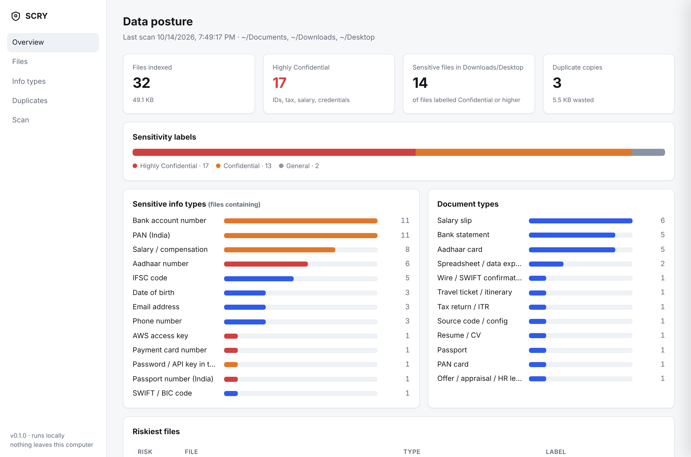
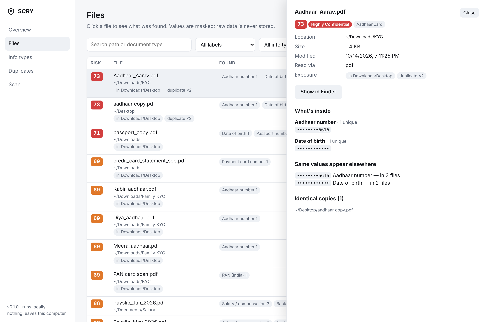

# SCRY

**See the sensitive data hiding in your files.**

SCRY scans the documents on your laptop and tells you what's in them: Aadhaar and PAN numbers, passports, bank account details, salary slips, tax returns, card numbers, passwords and API keys. It shows where each file lives, how exposed it is and how many copies you have, in a dashboard that runs entirely on your own computer.

> *To scry*: to see what is hidden.



---

## Why SCRY exists

Most of us have years of documents piled up in Downloads and Documents: KYC copies sent to a bank, payslips for a loan application, statements for a visa, screenshots of IDs from WhatsApp. We rarely know:

- **What** sensitive information is in those files
- **Where** it is, especially when it sits in Downloads, on the Desktop or in a folder that syncs to the cloud
- **How many copies** of the same passport scan or bank statement exist

Companies solve this with **Data Security Posture Management (DSPM)** tools such as Microsoft Purview, Varonis or BigID. SCRY brings the same idea to one person's laptop, and it keeps everything local.

## What it does

| | |
|---|---|
| 🔍 **Discovers** | Walks the folders you choose (Documents, Downloads and Desktop by default) and skips noise like apps, code libraries and caches. |
| 📄 **Reads** | PDF, Word, Excel, PowerPoint, CSV, text, email (.eml), HTML and code files. With OCR switched on, it also reads scanned PDFs, photos and screenshots. |
| 🧬 **Detects** | 20 types of sensitive information (see below). Each is checked with checksums and nearby keywords to avoid false alarms. |
| 🗂️ **Classifies** | Recognises 25+ kinds of document: passport, Aadhaar card, PAN card, Form 16, salary slip, bank statement, ITR, offer letter, SWIFT confirmation, resume and more. |
| 🏷️ **Labels** | Gives every file a sensitivity label, the same scheme Microsoft Purview uses: **General → Confidential → Highly Confidential**. |
| ⚠️ **Scores risk** | Rates each file 0–100 by what it contains and where it sits: Downloads or Desktop, cloud-synced folders (iCloud, OneDrive, Google Drive, Dropbox), readable by other users, stale or duplicated. |
| 📊 **Reports** | A local web dashboard, a summary in the terminal and a CSV export. |



## What it looks for

| Category | Information types |
|---|---|
| **Government IDs** | Aadhaar · PAN · Indian passport · Indian driving licence · US Social Security number · Canadian SIN |
| **Financial** | Credit and debit card numbers · bank account numbers · IFSC · SWIFT/BIC · IBAN · GSTIN |
| **Employment** | Salary and compensation details |
| **Personal** | Email addresses · phone numbers (India, US, Canada) · date of birth |
| **Secrets** | AWS access keys · private keys · GitHub tokens · passwords and API keys written in files |

### How it avoids false alarms

Pattern matching alone is not enough. In testing on a real laptop, a simple Aadhaar check flagged **2,650 numbers**. Every one was a 12-digit bank transaction reference that happened to pass the Aadhaar checksum, which about 1 in 10 random numbers do.

SCRY confirms each match in three ways, the same approach Microsoft Purview uses:

1. **Pattern**: the right shape (e.g. `ABCDE1234F` for PAN)
2. **Validation**: a checksum where one exists (Verhoeff for Aadhaar, Luhn for cards and SIN)
3. **Context**: a supporting keyword nearby ("Aadhaar", "card number", "passport"…)

With all three checks in place, those 2,650 false alarms went to zero.

## Your data stays yours

SCRY is built so that scanning your sensitive files doesn't create a new privacy risk.

- **Nothing leaves your computer.** There are no uploads, accounts, analytics or cloud calls. The dashboard loads nothing from the internet.
- **The real numbers are never saved.** SCRY stores a masked preview (`••••••••0124`) and a scrambled fingerprint so it can tell when the same number appears in several files. The original can't be recovered from either.
- **File contents are never saved.** Text is read in memory, checked and thrown away.
- **The dashboard is locked to your machine.** It listens on `127.0.0.1` only and blocks requests from websites or other devices.
- **One file holds everything.** Results live in `~/.scry/scry.db`, readable only by your user. Run `scry reset` to delete it.

## Install

You need **Python 3.9 or newer**. Macs have it; run `python3 --version` to check.

```bash
git clone https://github.com/<your-username>/SCRY.git
cd SCRY
python3 -m venv .venv
source .venv/bin/activate
pip install --upgrade pip
pip install -e .
```

**macOS:** give Terminal **Full Disk Access** (System Settings → Privacy & Security → Full Disk Access). Without it, macOS silently hides some folders from the scan.

**Optional: read scans, photos and screenshots (OCR)**

```bash
brew install tesseract poppler        # Ubuntu/Debian: sudo apt install tesseract-ocr poppler-utils
pip install -e ".[ocr]"
```

## Use

```bash
scry scan            # scan Documents, Downloads and Desktop
scry serve           # open the dashboard at http://127.0.0.1:8765
```

| Command | What it does |
|---|---|
| `scry scan` | Scans the default folders. Later scans only re-read files that changed. |
| `scry scan ~/Downloads ~/Desktop` | Scans specific folders. |
| `scry scan --ocr` | Also reads image-only files (needs the OCR install above). |
| `scry scan --full` | Re-reads every file, even unchanged ones. |
| `scry serve` | Opens the dashboard in your browser. Press Ctrl+C in the terminal to stop it. |
| `scry report` | Prints a summary in the terminal. |
| `scry export --out report.csv` | Saves the file inventory as a spreadsheet. Keep this private, because it lists your file names. |
| `scry reset` | Deletes all scan results. |

Coming back later:

```bash
cd SCRY && source .venv/bin/activate
scry scan && scry serve
```

### Try it on fake data first

```bash
pip install -e ".[dev]"
python scripts/make_demo_data.py demo-data
scry --db demo.db scan demo-data
scry --db demo.db serve
```

This creates about 30 realistic but fake documents (payslips, statements, ID copies, a leaked password) so you can explore SCRY without touching your real files. The screenshots above come from this demo data.

## The dashboard

- **Overview**: totals, sensitivity labels, which information types and document types were found, the riskiest files and the folders that need attention
- **Files**: search and filter by label, information type or document type. Click a file to see what's inside (masked), where else the same values appear, its identical copies and a **Show in Finder** button.
- **Info types**: every detector, how it works and how many files it matched
- **Duplicates**: identical copies grouped together, with the space each group wastes
- **Scan**: choose folders, switch OCR on or off and start a scan with live progress

## How it works

```
 Discover  →  Extract text  →  Detect info types  →  Classify document  →  Label + score  →  Dashboard
 (folders)    (PDF/Office/      (pattern+checksum     (filename +          (sensitivity ×
               OCR)              +context)             content rules)       exposure)
```

```
scry/
  detectors.py   information types, checksums, masking, fingerprints
  extract.py     reads text from each file type, optional OCR
  classify.py    document types, sensitivity labels, exposure and risk score
  scanner.py     finds files, rescans only what changed, spots duplicates
  store.py       local SQLite database
  cli.py         the `scry` command
  web/           the local dashboard (single page, no external assets)
scripts/make_demo_data.py   generates fake test documents
tests/                      automated tests
```

## Roadmap

- [ ] **Fix it, don't just find it**: move sensitive files into an encrypted folder, delete duplicates, tag files in Finder by label
- [ ] Look inside ZIP files and email attachments
- [ ] Use an on-device AI model to classify documents the rules can't place
- [ ] Watch mode: check new downloads as they arrive
- [ ] Add your own information types through a simple config file
- [ ] Export labels in Microsoft Purview format

## Limitations

SCRY uses rules and patterns, so it will sometimes flag something harmless or miss something real. Treat its results as a well-informed starting point for your own review, not a guarantee. Scan only computers and files you own or have permission to inspect.

## License

MIT. Free to use, change and share.
